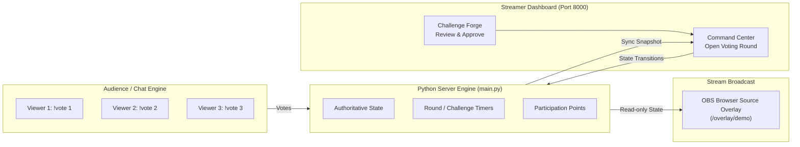

# 🎮 DareLoop Live · Twitch-x-Codex-hack

> **Interactive, streamer-controlled live challenge voting powered by Twitch and OBS.**  
> Community picks the path. You call the adventure.

[](https://www.python.org/)
[-success)](https://docs.python.org/3/)
[](https://dev.twitch.tv/)
[](https://obsproject.com/)
[](#features)

---

## 🌟 Overview

**DareLoop Live** bridges live streaming and audience participation through real-time interactive challenges. Viewers vote on what the streamer does next via chat commands, while the streamer retains complete control with strict safety guardrails.

This repository contains a **lightweight, dependency-free local MVP** built for rapid hackathon testing and live demonstrations. It includes an interactive **Streamer Command Center**, a simulated **Viewer Chat Engine**, and a transparent **OBS Browser Source Overlay**.

---

## ✨ Features

- 🛡️ **Streamer-in-Control Safety**: Dares must be explicitly approved in the *Challenge Forge* before entering the voting pool. Streamers can start, complete, or skip any active challenge at any time.
- ⏱️ **Server-Authoritative Timing & Votes**: The server owns all timers, voting rounds, score tallying, and deterministic tie-breaking.
- 🎥 **Clean OBS Browser Source Overlay**: Read-only, transparent, responsive overlay designed to drop directly into OBS Studio / Streamlabs.
- 🧪 **Built-in Demo Simulation**: Fully testable offline! Includes simulated viewers (`Maple`, `Orbit`, `Pixel`) and a demo chat box to simulate `!vote 1`, `!vote 2`, and `!vote 3` commands.
- 🔑 **Twitch OAuth Integration Ready**: Includes authorization-code grant flow, state validation, and channel profile verification.
- ⚡ **Zero External Dependencies for Memory Demo**: The default local demo runs entirely on the Python Standard Library (`http.server`, `threading`, `urllib`, `json`). No `pip install` required!

---

## 🏗️ Architecture & Flow



---

## 🚀 Quick Start

### Prerequisites

- **Python 3.10+** installed on your system.
- Modern web browser (Chrome, Edge, Firefox, Safari).

### 1. Clone & Enter Directory

```powershell
git clone https://github.com/Ruman2304/Twitch-x-Codex-hack.git
cd Twitch-x-Codex-hack
```

### 2. Launch the Local Server

No virtual environment or packages needed:

```powershell
python apps/api/app/main.py
```

*The server will start at `http://127.0.0.1:8000` with `DEMO_MODE=true`.*

### 3. Open the Interfaces

| Interface | URL | Purpose |
| :--- | :--- | :--- |
| **Streamer Command Center** | [http://127.0.0.1:8000](http://127.0.0.1:8000) | Review challenges, launch voting, monitor leaderboard |
| **OBS Studio Overlay** | [http://127.0.0.1:8000/overlay/demo](http://127.0.0.1:8000/overlay/demo) | Transparent on-screen browser source for your broadcast |

---

## 🕹️ Interactive Demo Walkthrough

1. **Review Challenges**: In **Challenge Forge**, review the seeded safe campus challenges and approve 2 or 3 candidates.
2. **Launch a Round**: In **Live Arena**, click **"Open voting round"**.
3. **Simulate Votes**:
   - Scroll down to the **Demo Chat** section.
   - Select viewer `Maple` and send `!vote 1`.
   - Select viewer `Orbit` and send `!vote 2`.
   - Watch audience participation points and live tallies update instantly.
4. **Resolve & Execute**:
   - Click **"Close vote"** to declare the winner.
   - Click **"Start challenge"** to run the live challenge timer.
   - Choose **"Complete"** or **"Skip"** when done.
5. **View in OBS**: Keep `http://127.0.0.1:8000/overlay/demo` open in another window or in OBS to watch the seamless real-time overlay sync!

---

## 🟣 Connecting Twitch (Optional)

To enable live Twitch account authorization:

1. Copy the example environment file:
   ```powershell
   cp .env.example .env
   ```
2. Register an application in the [Twitch Developer Console](https://dev.twitch.tv/console):
   - **OAuth Redirect URL**: `http://localhost:8000/api/v1/auth/twitch/callback`
3. Edit your `.env` file with your credentials:
   ```env
   TWITCH_CLIENT_ID=your_twitch_client_id
   TWITCH_CLIENT_SECRET=your_twitch_client_secret
   TWITCH_REDIRECT_URI=http://localhost:8000/api/v1/auth/twitch/callback
   DEMO_MODE=true
   ```
4. Restart the server (`python apps/api/app/main.py`). Click **"Connect Twitch"** in the top bar to test the OAuth grant flow.

*(See [`docs/TWITCH_SETUP.md`](docs/TWITCH_SETUP.md) for full EventSub and Helix setup specifications).*

---

## 📂 Repository Structure

```text
Twitch-x-Codex-hack/
├── apps/
│   ├── api/
│   │   └── app/
│   │       └── main.py          # HTTP transport, OAuth redirects, API
│   │       ├── services/        # Session, voting, approval and score rules
│   │       ├── integrations/    # Server-only Twitch HTTP adapter
│   │       └── persistence/     # Memory/PostgreSQL repositories and migrations
│   └── web/
│       ├── index.html           # Streamer Command Center layout
│       ├── styles.css           # Premium dark-mode UI & design tokens
│       ├── app.js               # Dashboard state polling & interactions
│       ├── overlay.html         # OBS Browser Source Canvas
│       └── overlay.js           # Read-only overlay polling & animations
├── docs/
│   ├── ARCHITECTURE.md          # Architecture decisions, trust boundaries & target spec
│   └── TWITCH_SETUP.md          # Twitch API, Helix, and EventSub integration roadmap
├── .env.example                 # Environment variables template
├── AGENTS.md                    # Core architecture principles and safety rules
├── TASKS.md                     # Roadmap and milestone tracking
└── README.md                    # Project documentation
```

---

## 🔒 Security & Trust Boundaries

- **Zero Secret Leakage**: Twitch secrets and API credentials never reach the browser or client bundle.
- **Strict Input Sanitization**: Viewer text is treated as untrusted; only strict `!vote <1-3>` commands are parsed.
- **Server Enforced State**: Challenge transitions, round timers, and score allocations are strictly authoritative on the server.
- **Privacy First**: No precise geolocation or personal viewer tracking.

---

## 🗺️ Roadmap

- [x] **P0 Core**: Dependency-free local demo server with Challenge Forge, Live Arena, and OBS Overlay.
- [x] **P0 Auth**: Twitch OAuth 2.0 authorization-code flow and channel validation.
- [x] **P0 Game Persistence**: PostgreSQL storage and migrations with transactional votes and score constraints; enabled with `DATABASE_URL`. Encrypted OAuth storage/refresh is available with TOKEN_ENCRYPTION_KEYS.
- [ ] **P0 Realtime**: WebSocket real-time event streaming replacing HTTP polling.
- [x] **P0 Chat EventSub**: Server-side `channel.chat.message` receiver with persistent inbox deduplication and connection recovery. Real-provider manual testing remains pending.
- [ ] **P1 Features**: Viewer challenge suggestions, safety moderation queue, team competitions.

---

## 📄 License

Distributed under the MIT License. Built with ❤️ for the Twitch x Codex Hackathon.

## Frontend design preview

The `bilal/frontend` branch refreshes the Command Center with a charcoal and lime broadcast workspace, an authored campus illustration, a central arena, voting cards, challenge review, a simulated chat panel, and a matching transparent overlay. It uses the existing local demo API; real Twitch chat is implemented on the backend branch; AI generation remains pending.

Start the server with `python3 apps/api/app/main.py`, then open `http://127.0.0.1:8000`. Approve at least two challenges, open voting, send votes as the demo viewers, close voting, and start the winner. Complete or skip to reveal the next-round control. The connection panel copies the OBS URL and resets the demo. Session pause now freezes round and challenge timers on the server. Resume restores the remaining time. You can skip a round before starting, complete or skip a paused challenge, and end a session.

Frontend checks: `node --check apps/web/app.js` and `node --check apps/web/overlay.js`. Browser review is still required at 375px, 768px, 1280px, 1440px, and for the 1920×1080 OBS source; keyboard navigation, text contrast, and network recovery should be reviewed there as well.


## Backend lifecycle slice

Run `python3 -m unittest discover -s tests -v` for the backend regression suite. It covers deadline boundaries, repeated/concurrent votes, participation idempotency, approval revocation, repeated attempts, pause/resume, end/skip controls, request validation, creator ownership, and browser-bound OAuth state. Tests run offline and use no real credentials.

With `DEMO_MODE=true`, local simulated controls remain available without sign-in. With `DEMO_MODE=false`, configure PostgreSQL first, then sign in with Twitch and use **Create live session** in setup. Reads and actions then require that creator's session cookie. The lifecycle slice began with one in-memory workspace. PostgreSQL game persistence is now available as described below. Encrypted durable accounts and token refresh are now available with TOKEN_ENCRYPTION_KEYS. Multiple session routes, scoped live overlay tokens and browser WebSockets remain pending. EventSub chat is now implemented. The unauthenticated OBS demo is intended for demo mode only.

New lifecycle endpoints: `POST /api/v1/sessions`, `POST /api/v1/session/resume`, `POST /api/v1/session/end`, and `POST /api/v1/rounds/skip`. The existing pause endpoint toggles pause/resume for frontend compatibility. Complete and skip remain available while paused; new rounds and votes require a live session.


## PostgreSQL persistence

Follow [database setup](docs/DATABASE_SETUP.md) to install the optional driver, configure `DATABASE_URL`, and apply migrations. With PostgreSQL configured, sessions, challenges, approvals, rounds, votes, timers, scores, and activity recover across restarts. The server rejects unavailable storage rather than silently falling back to memory. With TOKEN_ENCRYPTION_KEYS configured, Twitch credentials are encrypted at rest and opaque browser sessions also recover after restart. See docs/TWITCH_SETUP.md.

Without `DATABASE_URL`, `DEMO_MODE=true` still runs using memory and does not preserve state across server restarts. Live mode now requires a database. PostgreSQL integration tests are opt-in through `TEST_DATABASE_URL`; the standard offline suite reports them as skipped when no test database is configured.


## Durable Twitch sign-in

See [Twitch setup](docs/TWITCH_SETUP.md) to register the app and configure `TOKEN_ENCRYPTION_KEYS`. PostgreSQL stores encrypted access/refresh tokens and hashed browser sessions. The backend validates at startup and hourly, serializes reactive refreshes, preserves rotated refresh tokens, and ends sessions if authorization is revoked. Disconnect invalidates local sessions immediately and retries provider revocation through an encrypted queue if Twitch is unavailable.

The no-credentials demo remains available. Automated account tests use a fake provider; real Twitch consent and chat delivery still need manual verification. Never commit your Twitch client secret, database password, or encryption key.


## Test real Twitch chat

The backend now receives creator-channel votes through Twitch EventSub, deduplicates event and chat IDs, and commits each vote and participation point together. It supports connection recovery and requires no viewer installation or chat-write scope. Demo mode remains separate and clearly labeled.

Follow the complete [live chat setup and test guide](docs/LIVE_CHAT_TEST.md). On this Mac, `python3 scripts/dev_db.py start` starts an isolated project PostgreSQL database without Docker or your existing database's administrator password. Copy its printed DATABASE_URL into the ignored `.env`, set the Twitch credentials/encryption key and `DEMO_MODE=false`, apply migrations, and start the API.

Manual chat testing needs your registered Twitch application, browser consent, and two viewer accounts. A signed-in browser can preview the overlay, but scoped live OBS access is still the next feature; live overlay URL copying is disabled until then. Automated EventSub tests use fixture sockets and notifications, not real Twitch.


### Creator custom challenges

In **Challenge Forge**, click **Add challenge**, enter a title, instructions, category and duration (30–1800 seconds), confirm that you reviewed its safety, then choose **Save for review**. The challenge stays pending until you explicitly approve it. Use **Next vote** checkboxes to select two or three approved challenges; uncheck an older choice to include a new one. The active round is unchanged by saving drafts or changing next-round selections.

Custom drafts and approvals persist in PostgreSQL within the current session. Ending a session and creating a new one starts a fresh challenge pool. The curated suggestions remain available separately. Validation checks field types, text limits, duration and the creator's acknowledgement; automated AI moderation remains pending. Viewer-created suggestions are not included.
