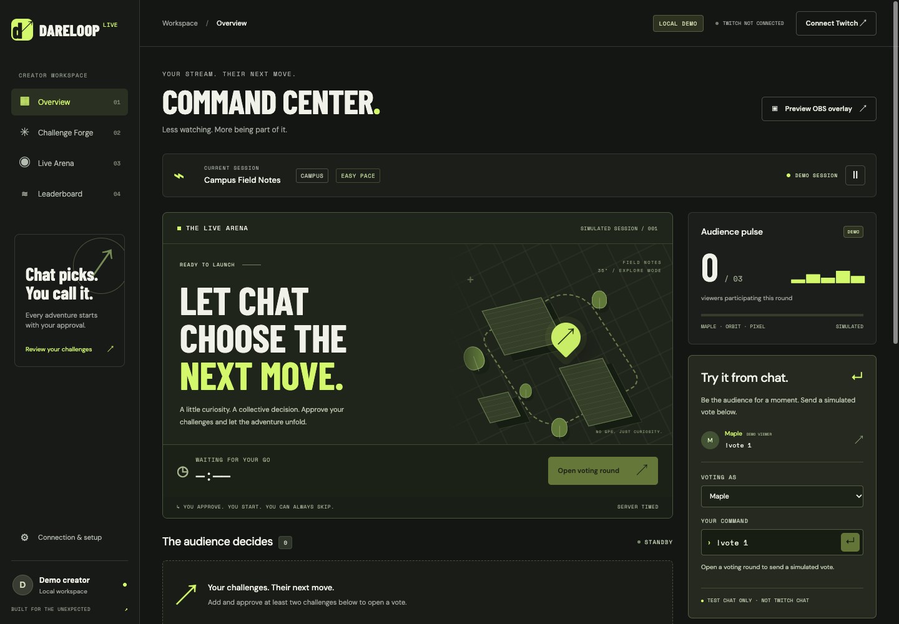
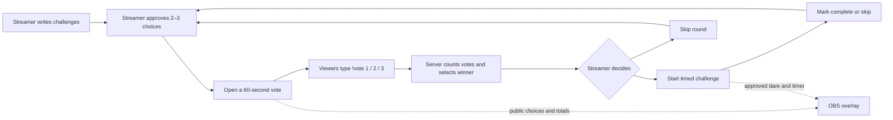
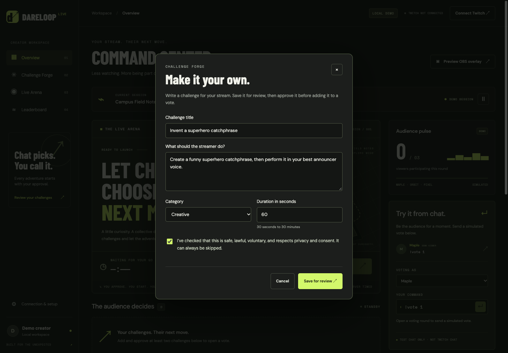
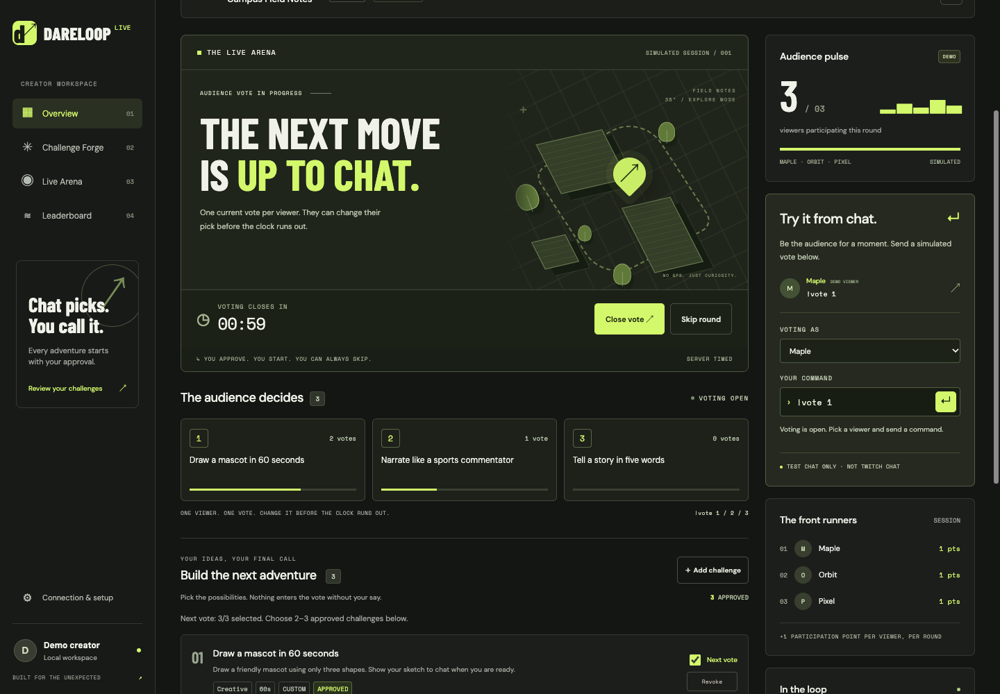
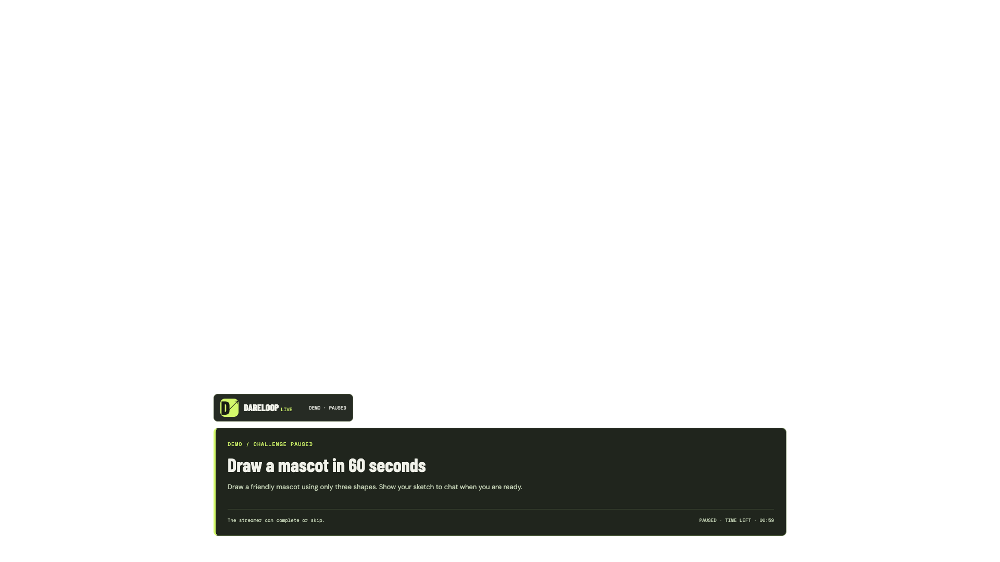
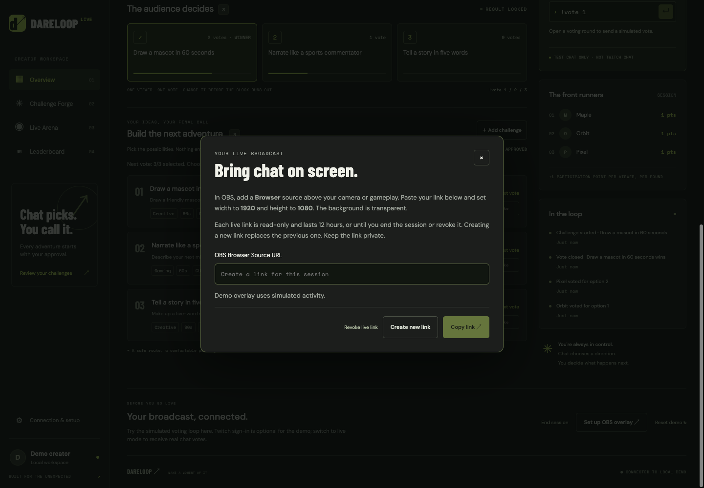

# DareLoop Live

**Let Twitch chat choose your next challenge. You approve it. You decide when to start.**

DareLoop is a local streamer dashboard with Twitch chat voting and a transparent OBS overlay. Write your own dares, approve two or three choices, open a vote, and perform—or skip—the winning challenge while viewers follow along on stream.

It is a **companion web app and OBS Browser source**, not a Twitch Extension or a replacement for OBS. Viewers participate in normal Twitch chat and install nothing.



[User manual](docs/USER_MANUAL.md) · [Live Twitch setup](docs/LIVE_CHAT_TEST.md) · [OBS setup](docs/OBS_SETUP.md) · [Database setup](docs/DATABASE_SETUP.md) · [Architecture](docs/ARCHITECTURE.md)

> Screenshots are captured from the actual application using isolated, clearly labeled demo data. Example challenges are created only for the screenshots. **New sessions start empty; there are no built-in presets.** No real account, camera feed, credentials, or private OBS links appear in these images.

## How a stream works



1. The streamer signs in with Twitch and creates a DareLoop session.
2. They use **Add challenge**, save each draft, and explicitly approve it.
3. They select two or three **Next vote** choices and open voting.
4. Viewers send `!vote 1`, `!vote 2`, or `!vote 3` in the streamer's Twitch chat.
5. The server closes voting after 60 seconds, or the streamer closes it early.
6. The winning dare waits for **Start challenge**. Nothing starts automatically.
7. The streamer completes or skips the dare and opens another round.

A DareLoop session is separate from a Twitch broadcast. Starting one does not start OBS streaming, and ending one does not stop the broadcast.

## What works today

| Feature | Current behavior |
| --- | --- |
| Creator challenges | Write title, instructions, category and a 30–1800 second duration. New sessions contain no preset challenges. |
| Explicit review | Save as pending, approve/reject, restore/revoke. Unapproved text stays out of the OBS feed. |
| Round selection | Choose two or three approved challenges for the next vote. Saving another draft does not change an active round. |
| Real Twitch chat | OAuth sign-in and server-side EventSub WebSocket ingestion from the creator's channel. Viewers use normal chat. |
| Voting | One current vote per Twitch identity per round. Changing a vote replaces the earlier choice. Duplicate deliveries are deduplicated. |
| Server timers | 60-second voting, configurable dare duration, authoritative deadlines, pause/resume, early close and skip controls. |
| Participation points | One point per participating viewer per round. Repeating/changing a vote adds no extra points. |
| Leaderboard | Per-session participation ranking with Twitch display names; demo uses Maple, Orbit and Pixel. |
| OBS overlay | Transparent 1920 × 1080 Browser source showing choices, totals, winner, dare instructions and remaining time. |
| Overlay access | Read-only, session-scoped links; 12-hour expiry, rotation and revocation. No Twitch login inside OBS. |
| Persistence | PostgreSQL preserves challenges, approvals, votes, rounds, scores, timers and encrypted Twitch connections across restarts. |
| Recovery | EventSub reconnect handling, token validation/refresh, duplicate-event protection and clear connection states. |
| Local demo | A separate, labeled simulation with no Twitch account or database required. |

### Challenge creation and approval



Save a draft, review it, approve it, then tick **Next vote**. An already selected set of three must have one choice unchecked before another can be added. Validation enforces field limits and the creator's safety acknowledgement. **Automated AI moderation and AI dare generation are not implemented.**

### Voting and participation



The dashboard and overlay fetch server snapshots about once per second. Twitch ingestion itself uses EventSub WebSockets; browser WebSocket delivery remains future work. DareLoop reads chat and does not post chat confirmations.

### OBS output



The PNG above has a transparent background. In OBS, the overlay sits over your own camera or gameplay. The screenshot shows a paused demo challenge; the live mode uses the same layout with Twitch status.

## Quick start: no-account demo

Requirements: Python **3.10+** and a modern browser. Development has been verified with Python 3.12. The memory-only demo uses the Python standard library; no frontend build or package manager is needed.

```bash
git clone https://github.com/Ruman2304/Twitch-x-Codex-hack.git
cd Twitch-x-Codex-hack
DEMO_MODE=true DATABASE_URL= TWITCH_CLIENT_ID= TWITCH_CLIENT_SECRET= TOKEN_ENCRYPTION_KEYS= python3 apps/api/app/main.py
```

Open **http://localhost:8000**. The explicit environment overrides above keep this demo separate from any existing live `.env` settings. If port 8000 is occupied, stop the other DareLoop process or set `PORT=8001` in the same command and use that port.

1. Open **Challenge Forge → Add challenge** and create at least two dares.
2. Save and approve each one; select the **Next vote** checkboxes.
3. Click **Open voting round**.
4. In the simulated chat controls, select Maple/Orbit/Pixel and send votes.
5. Close the vote, start the winner, then mark complete or skip.
6. Use **Preview OBS overlay** to see the broadcast graphics.

In memory mode, stopping the process loses demo state. **Reset demo** also creates a fresh empty session.

## Run with real Twitch chat

Requirements: a Twitch creator account and registered developer application, PostgreSQL, and the backend dependencies. OBS is needed to broadcast the overlay; it is not needed just to test chat ingestion.

### 1. Install dependencies

```bash
python3 -m venv .venv
.venv/bin/python -m pip install -r apps/api/requirements.txt
```

These commands use a macOS/Linux shell. On Windows, use the equivalent `.venv\Scripts\python.exe` commands and a dedicated PostgreSQL database or Docker.

### 2. Configure the database and Twitch application

On macOS with PostgreSQL installed:

```bash
python3 scripts/dev_db.py start
```

Copy the helper's printed `DATABASE_URL` into the ignored root `.env`. It creates a separate database in `.local/postgres`, using a private Unix socket. For Docker or an existing database, see [database setup](docs/DATABASE_SETUP.md).

In the [Twitch Developer Console](https://dev.twitch.tv/console/apps), register this exact OAuth Redirect URL:

```text
http://localhost:8000/api/v1/auth/twitch/callback
```

Follow Twitch's [application registration guide](https://dev.twitch.tv/docs/authentication/register-app/) for account verification, 2FA and application credentials. DareLoop uses the creator's `user:read:chat` grant; no separate bot account is required for this local flow.

For a fresh checkout, copy `.env.example` to `.env`. Preserve an existing `.env` and its encryption key when updating the project. Configure:

```dotenv
DEMO_MODE=false
DATABASE_URL=YOUR_DEDICATED_DATABASE_CONNECTION_STRING
DATABASE_WORKSPACE=default
TWITCH_CLIENT_ID=YOUR_APP_CLIENT_ID
TWITCH_CLIENT_SECRET=YOUR_APP_CLIENT_SECRET
TWITCH_REDIRECT_URI=http://localhost:8000/api/v1/auth/twitch/callback
TOKEN_ENCRYPTION_KEYS=YOUR_GENERATED_FERNET_KEY
TWITCH_EVENTSUB_ENABLED=true
```

Generate the encryption key locally:

```bash
.venv/bin/python -c "from cryptography.fernet import Fernet; print(Fernet.generate_key().decode())"
```

Keep this key across restarts. Never commit `.env`, real credentials, database files or OBS capability URLs. An OpenAI API key and an EventSub webhook secret are not needed by the current feature set.

### 3. Migrate and start

```bash
.venv/bin/python -m apps.api.app.persistence.migrate
.venv/bin/python apps/api/app/main.py
```

Open **http://localhost:8000**, click **Connect Twitch**, authorize the app, then choose **Connection & setup → Create live session**. Wait for **TWITCH CHAT CONNECTED**. Add and approve your own challenges before opening a round.

The frontend and API are served together on port 8000. No second frontend server is required. Detailed checks, two-viewer testing and troubleshooting are in [the live walkthrough](docs/LIVE_CHAT_TEST.md).

## Add the overlay in OBS



1. In DareLoop, select **Connection & setup → Set up OBS overlay**.
2. Choose **Create new link → Copy link**.
3. In OBS, choose your scene, then **Sources → + → Browser**.
4. Paste the link into **URL**; leave **Local file** unchecked.
5. Set **Width: 1920** and **Height: 1080**.
6. Place the Browser source above the camera/gameplay in the Sources list and fit it to the canvas.
7. Open a round and verify the choices appear. Start the winning challenge to see its countdown.

Keep the local API running on the same computer as OBS. Each live link expires after 12 hours and is invalidated by replacement, revocation, session end/replacement or Twitch disconnect. A new session needs a new OBS link. See [OBS setup](docs/OBS_SETUP.md) and the [OBS Browser Source reference](https://obsproject.com/kb/browser-source).

## Documentation

| Guide | Contents |
| --- | --- |
| [User manual](docs/USER_MANUAL.md) | Every screen and control, challenge lifecycle, voting rules, score rules, OBS, restart behavior and troubleshooting. |
| [Live chat walkthrough](docs/LIVE_CHAT_TEST.md) | Twitch app setup and repeatable real-provider checks. |
| [OBS setup](docs/OBS_SETUP.md) | Browser source configuration, link lifecycle and troubleshooting. |
| [Database setup](docs/DATABASE_SETUP.md) | Local helper, Docker, migrations, storage and test databases. |
| [Twitch setup](docs/TWITCH_SETUP.md) | OAuth, encryption keys, refresh, cookies and disconnect behavior. |
| [Architecture](docs/ARCHITECTURE.md) | Current implementation, trust boundaries and target architecture. |
| [Task tracker](TASKS.md) | Implemented slices and remaining work. |
| [Screenshot notes](docs/screenshots/README.md) | Image provenance and how to recapture them. |

## Development and verification

```bash
.venv/bin/python -m unittest discover -s tests -q
node --check apps/web/app.js
node --check apps/web/overlay.js
node tests/test_overlay_frontend.cjs
```

The Python suite includes HTTP tests that bind ephemeral localhost ports. PostgreSQL cases run when `TEST_DATABASE_URL` points to a **separate disposable test database**; otherwise they are skipped. Never use your active streaming database for tests. The complete suite currently has **179 tests**, including the PostgreSQL cases. Automated Twitch tests use fixtures, not real credentials.

The creator has also manually verified real Twitch sign-in, chat votes, custom challenge creation and the overlay in OBS. This is local prototype verification, not a claim of production load testing.

Capture updated documentation images without using the active game or real account:

```bash
.venv/bin/python scripts/capture_screenshots.py
```

Requires Chrome/Chromium and the installed backend dependencies. Set `CHROME_BIN` or pass `--chrome /path/to/chrome` when necessary. See [screenshot notes](docs/screenshots/README.md).

```text
apps/api/app/
  main.py                 HTTP routes, cookies and static files
  services/               Sessions, challenges, voting, scores, accounts, overlays
  integrations/           Twitch HTTP, chat parsing and EventSub receiver
  persistence/            Memory/PostgreSQL repositories and SQL migrations
  security/               Credential encryption
apps/web/                 Static dashboard, OBS overlay and styles
scripts/                  Local database helper and screenshot capture
infra/                    Optional PostgreSQL Docker Compose configuration
tests/                    Domain, HTTP, persistence, Twitch and overlay checks
docs/                     User manual, setup guides and screenshots
```

## Current limits and next work

- One active creator workspace per configured server; this is not yet a hosted multi-creator service.
- Dares are written by the streamer. No AI generation, automated policy moderation or viewer submissions yet.
- Browser updates poll once per second. A versioned browser WebSocket feed remains pending.
- Reconnection restores EventSub intake, but Twitch does not replay messages missed during a hard outage. [Twitch WebSocket recovery behavior](https://dev.twitch.tv/docs/eventsub/handling-websocket-events/).
- Challenge completion is declared by the streamer; there is no camera analysis or proof verification.
- No edit/delete UI for saved custom dares. Reject/revoke an unwanted one or create a replacement. New sessions start a fresh pool.
- Public HTTPS deployment, operational rate limiting, retention jobs and broader browser/load testing remain pending. Keep this development server local.

Codex was used to build and iterate on the frontend, server lifecycle, persistence, Twitch integration, custom challenges, OBS access, tests and documentation. AI challenge generation is a separate unfinished product feature.
