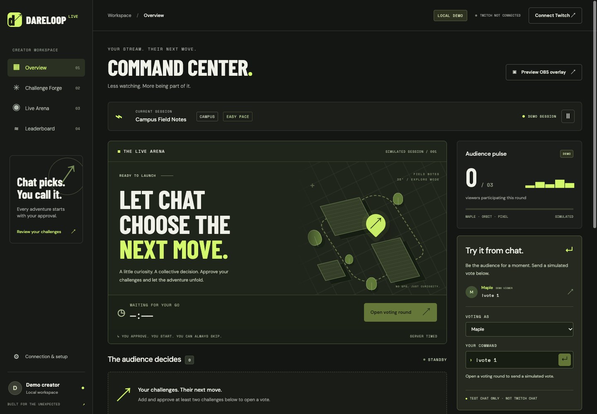
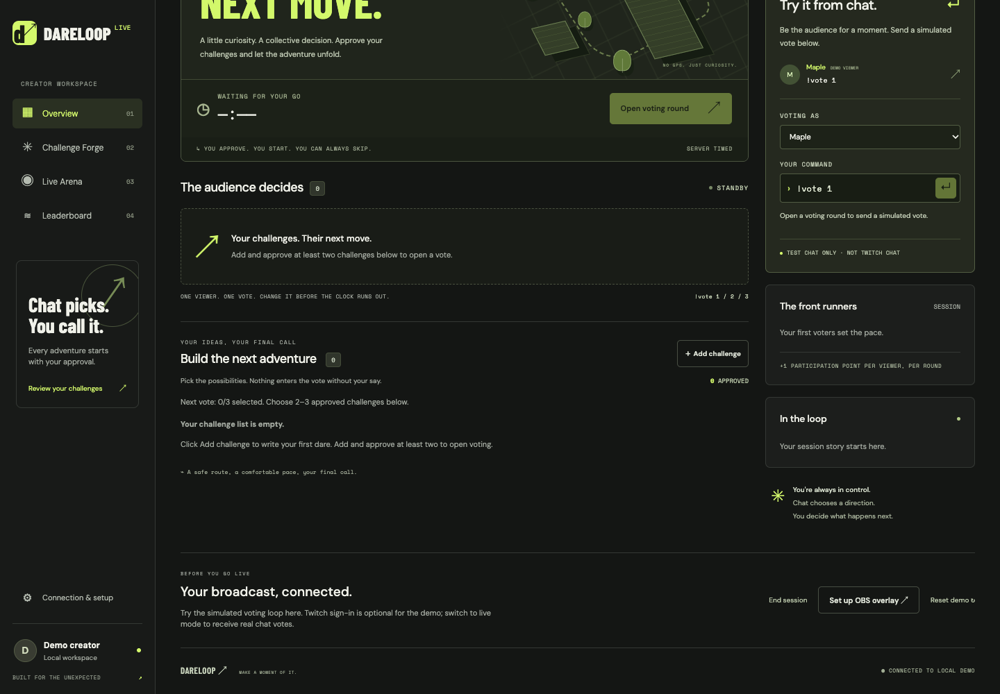
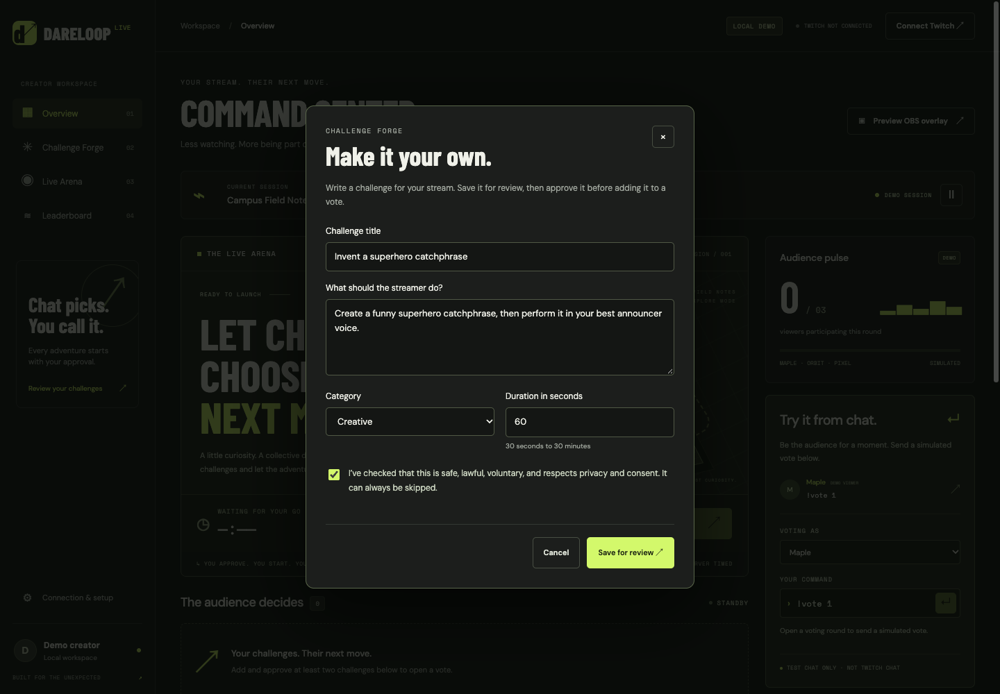
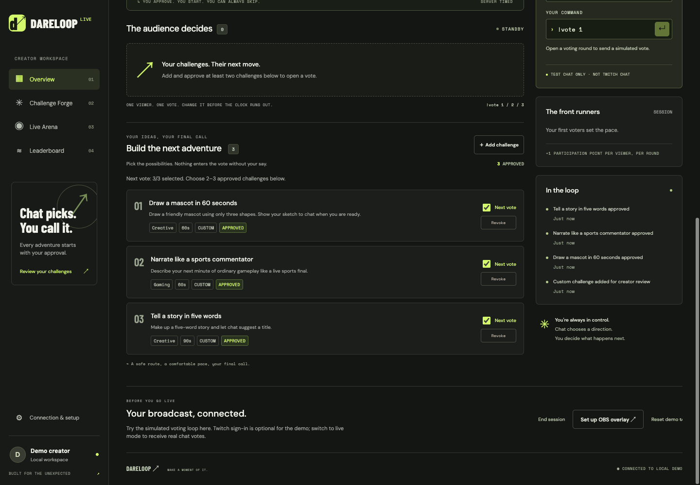
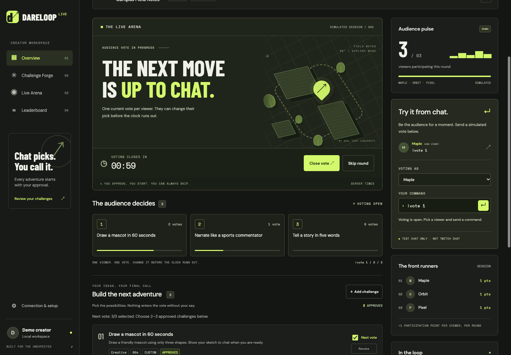
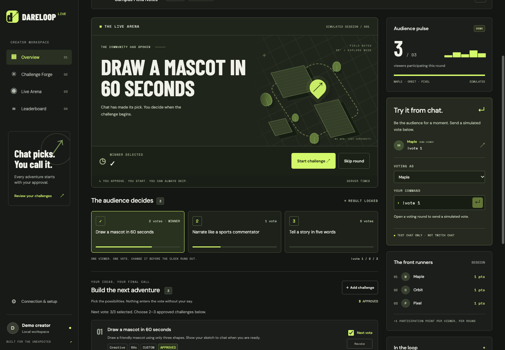
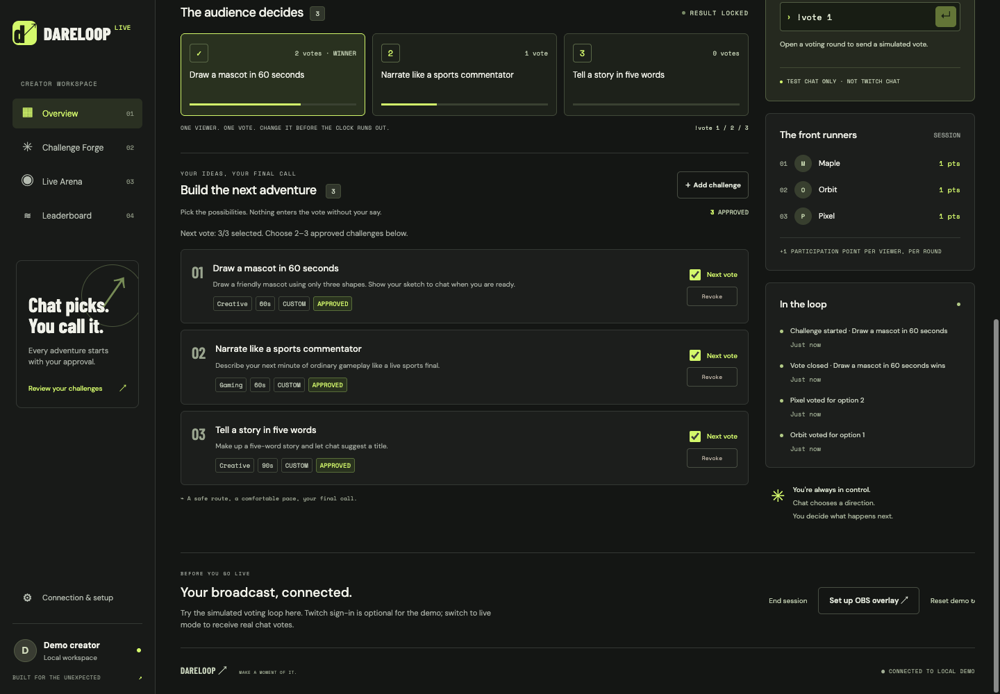
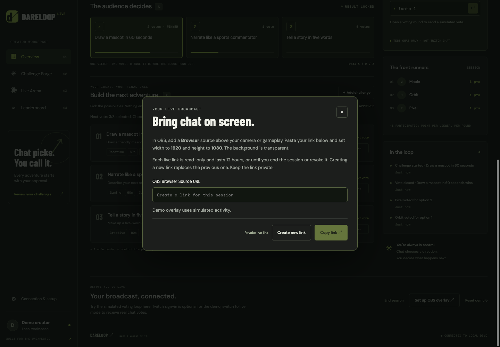
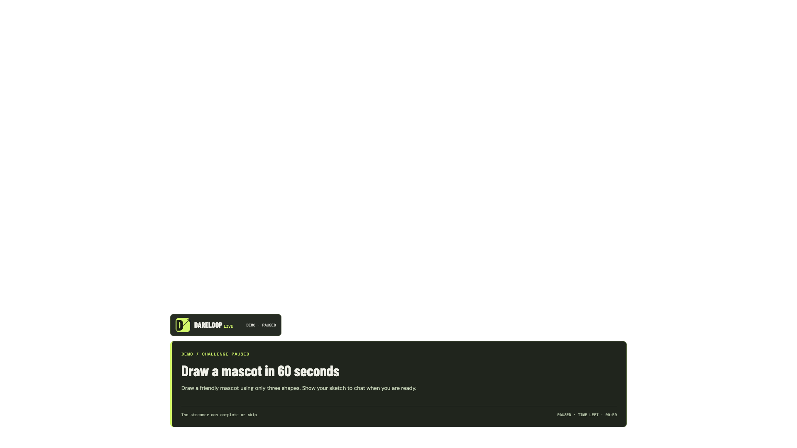

# DareLoop Live — streamer and viewer manual

DareLoop lets Twitch chat vote on dares that **you write and approve**. The streamer controls the vote, decides whether to start the winner, and can always skip. OBS shows the public choices and timer over a camera or game.

[Project overview and installation](../README.md) · [Twitch setup](LIVE_CHAT_TEST.md) · [OBS setup](OBS_SETUP.md) · [Database setup](DATABASE_SETUP.md)

## Contents

1. [What each part does](#1-what-each-part-does)
2. [Start the app](#2-start-the-app)
3. [Navigate the dashboard](#3-navigate-the-dashboard)
4. [Create and approve your dares](#4-create-and-approve-your-dares)
5. [Select and open a vote](#5-select-and-open-a-vote)
6. [How viewers participate](#6-how-viewers-participate)
7. [Run the winning challenge](#7-run-the-winning-challenge)
8. [Pause, skip and end a session](#8-pause-skip-and-end-a-session)
9. [Points and leaderboard](#9-points-and-leaderboard)
10. [Put the overlay in OBS](#10-put-the-overlay-in-obs)
11. [Refresh, restart and reconnect](#11-refresh-restart-and-reconnect)
12. [Troubleshooting](#12-troubleshooting)
13. [Repeatable end-to-end test](#13-repeatable-end-to-end-test)
14. [Developer reference and limits](#14-developer-reference-and-limits)

All screenshots below are actual application renders from an isolated **LOCAL DEMO**. Their example challenges were explicitly created for documentation. They are not presets, real Twitch accounts or a recording of a public broadcast.

## 1. What each part does

| Part | Who uses it | Purpose |
| --- | --- | --- |
| DareLoop dashboard | Streamer | Write/review challenges, manage votes, start/complete/skip dares and view participation. |
| Twitch chat | Viewers | Send `!vote 1`, `!vote 2` or `!vote 3` while voting is open. No DareLoop account or installation. |
| OBS Studio | Streamer | Broadcast camera/gameplay to Twitch and display the DareLoop Browser source above it. |
| OBS overlay | Audience | See approved choices, totals, the winning dare and time remaining. Has no game controls. |
| Local API and database | Streamer's computer | Authoritative voting, deadlines, scoring, session storage and Twitch integration. |

**This is a companion app, not a Twitch Extension.** The current installation runs locally. Viewers never need your `localhost` address or your private OBS link.

A **DareLoop session** groups your challenge pool, rounds and participation points. A **voting round** is one choice between two or three approved dares. A **challenge attempt** starts only when you press **Start challenge**. A **Twitch broadcast** starts and stops through OBS independently of these controls.

## 2. Start the app

### Try the simulation

Follow the [README demo quick start](../README.md#quick-start-no-account-demo). Open `http://localhost:8000`. Look for **LOCAL DEMO**, **DEMO SESSION** and the simulated viewer names Maple, Orbit and Pixel. Actions here do not read real Twitch chat.

The demo starts with an empty pool. Add at least two challenges before voting. The simulator is hidden when running with real Twitch integration.

### Use real Twitch chat

First follow the [live setup walkthrough](LIVE_CHAT_TEST.md). It covers PostgreSQL, the registered Twitch application, the exact redirect URL, encryption key and dependencies. Then:

```bash
python3 scripts/dev_db.py start
.venv/bin/python -m apps.api.app.persistence.migrate
.venv/bin/python apps/api/app/main.py
```

The database-helper command applies to the local Unix-socket setup. If using Docker or another dedicated PostgreSQL database, start that database instead.

1. Open `http://localhost:8000`.
2. Click **Connect Twitch**, sign in as the channel creator and authorize the application.
3. Open **Connection & setup** and select **Create live session** if no session is active.
4. Wait for **TWITCH CHAT CONNECTED**.
5. Add your dares and approve them.

An existing active session should recover automatically. Do not create a replacement just because you refreshed the page. Only the owning creator can manage the live workspace.

## 3. Navigate the dashboard



| Screen or panel | What to expect |
| --- | --- |
| **Overview / Command Center** | Session status, main arena, current voting or dare controls, audience count and connection information. |
| **Challenge Forge** | Your pending, approved and rejected challenges; **Add challenge** and **Next vote** selection. |
| **Live Arena** | The current round/attempt and its server timer. The main action changes with the lifecycle. |
| **Leaderboard / The front runners** | Participation points earned during this session. |
| **In the loop** | Creator-facing activity such as challenge review, votes and lifecycle changes. This is not included in the public OBS projection. |
| **Connection & setup** | Create/end session, OBS setup and demo reset. The header provides Twitch connect/disconnect. |
| **Preview OBS overlay** | Opens a viewer-facing preview in your current signed-in browser. |

The current session title/context, such as “Campus Field Notes,” are prototype labels. There is no location tracking or context editor in the current UI. You can write gaming, at-home or creative challenges regardless of that label.

## 4. Create and approve your dares

### Empty sessions are intentional



There are no fixed six challenges anymore. Existing legacy presets are retired from the review pool and cannot enter new votes or the public overlay. Your own saved challenges are retained within their session.

### Add a challenge

1. Select **Challenge Forge → Add challenge**.
2. Fill in the fields below.
3. Read the safety acknowledgement and check it only after reviewing the dare.
4. Choose **Save for review**.
5. Find the new pending card and click **Approve** when ready.



| Field | Rules and example |
| --- | --- |
| Challenge title | Required; up to 80 characters. Example: “Draw a mascot in 60 seconds.” |
| What should the streamer do? | Required instructions, up to 1,000 characters. Explain a specific, voluntary activity. |
| Category | Creative, Gaming, Observation, At home or Other. |
| Duration | Whole seconds, from 30 to 1,800. For example, `60` means one minute. |
| Safety acknowledgement | Required confirmation that you reviewed safety, consent, privacy and voluntary participation. |

The server validates the submitted data; browser validation alone is not trusted. A session supports up to 100 non-archived challenges. Drafts can be saved during a vote or while paused, but cannot change an active round.

**Saving is not approving.** A pending or rejected challenge is not eligible for voting. The OBS endpoint excludes the review pool and rechecks approval for any public challenge text.

The current product does not automatically judge whether a dare is safe and does not use AI to generate or moderate it. Choose appropriate content yourself and skip whenever needed. There is no precise-location requirement or proof upload.

### Review controls

| Control | Effect |
| --- | --- |
| **Approve** | Makes a pending dare eligible for selection. It does not start the dare. |
| **Reject** | Keeps it out of voting. |
| **Revoke** | Removes approval from an approved card. |
| **Restore** | Marks a rejected card approved again after your review. |
| **Next vote** | Selects an approved card for the next round. Does not change the current round's choices. |

The dashboard asks you to close the active vote before changing approvals. There is no edit/delete control for a saved custom dare yet. If you want different wording, add a replacement and reject/revoke the old card.

## 5. Select and open a vote



1. Approve at least two challenges.
2. Check **Next vote** on the two or three you want.
3. If three are selected, uncheck one before selecting another.
4. Go to **Live Arena** and click **Open voting round**.
5. Tell viewers to follow the numbered choices shown on screen.

Numbers are assigned when the round opens; use those numbers in chat. At most three options appear. You can prepare a different selection while a round runs, but its existing choices remain fixed.



Every vote lasts **60 seconds** unless you close it early or pause the session. The server owns that deadline and the vote totals. Dashboard and OBS updates arrive by polling roughly once per second.

**Open voting round** is unavailable when fewer than two choices are selected, Twitch chat is not connected in live mode, the connection is lost, or the previous round/attempt still needs a creator decision.

### Result rules

- **Close vote** locks the result immediately; the deadline also closes it automatically.
- The option with the most current votes wins.
- A tie chooses the lowest option number among tied choices.
- If nobody votes, the same rule selects option 1. You can skip that round.
- Late votes do not alter a closed result.
- A selected winner waits for your approval to start: press **Start challenge** or **Skip round**.

## 6. How viewers participate

Viewers open the streamer's normal Twitch chat, sign in to Twitch, and send:

```text
!vote 1
!vote 2
!vote 3
```

Only numbers that exist in the current round count. With two choices, `!vote 3` does not count. Capitalization and spacing are tolerated, but normal conversation, `!vote 4` and `!vote 1 please` are ignored.

Each Twitch identity has **one current vote per round**. Sending another valid number before the deadline replaces that viewer's earlier choice. Repeating the same command does not add another vote. Duplicate EventSub notifications are also deduplicated by the server.

There is no chat reply from DareLoop. Viewers see counts change in the overlay and the streamer sees them in the dashboard. Audience pulse is the number of participants in the current round, **not the channel's total live viewer count**.

### In demo mode

Select Maple, Orbit or Pixel from the simulated chat dropdown and submit the same commands. These are local test identities, not Twitch accounts. This control is intentionally hidden in live mode.

## 7. Run the winning challenge



1. Review the winner and the situation on stream.
2. Click **Start challenge** to begin its configured timer, or **Skip round** to move on.
3. The overlay changes from the community pick to the dare title, instructions and time left.
4. When finished, click **Mark complete**. You may instead **Skip challenge** at any time.
5. Choose the next two or three approved dares and click **Open next round**.

The app never forces the winner to start. It also does not automatically declare success. If the timer reaches zero, the attempt becomes **expired** and waits for the streamer to mark an outcome. Complete or skip it before opening another round.

Only one active round and one attempt for that round are allowed. Repeated start/completion commands cannot create extra attempts or points.

## 8. Pause, skip and end a session

| Action | What happens |
| --- | --- |
| Pause button beside the session | Freezes the remaining vote or challenge time on the server. Votes sent while paused do not count. |
| Resume | Continues from the frozen remaining time. Paused chat commands are not replayed. Viewers must send a fresh vote. |
| **Skip round** | Cancels an open vote or an unstarted winner. No dare starts. |
| **Skip challenge** | Ends the current attempt without claiming completion. Available while paused too. |
| **End session** | Closes the DareLoop session and active work. The old session no longer accepts drafts, votes or new rounds. Its OBS link stops working. |
| **Create live session** | Creates a fresh empty challenge pool and a new participation leaderboard after the previous session ended. |
| **Reset demo** | Replaces the simulated session with a fresh empty demo. Does not reset the separate live workspace. |

**“Session ended” is a DareLoop state, not a server error.** Restarting the server preserves it when using PostgreSQL. Close any open form, choose **Connection & setup → Create live session**, and add new challenges. Copy unsaved form text before leaving it; a form draft is not persisted until saved.

Ending the DareLoop session does not press **Stop Streaming** in OBS. Conversely, stopping OBS does not automatically end DareLoop. Manage each intentionally.

## 9. Points and leaderboard



A viewer earns **one participation point for their first counted vote in each round**. They can earn another point in the next round. Vote changes and repeated notifications do not award more points.

Points are keyed by Twitch identity on the server, with display names shown on screen. This is a session leaderboard, not a global ranking. A new session starts fresh. Challenge completion does not currently award extra viewer points, and there is no winner-prediction bonus.

## 10. Put the overlay in OBS

The overlay is a transparent page intended for an **OBS Browser source**. You do not need to screen-capture the private dashboard.



### Create the link

1. Have an active live DareLoop session.
2. Open **Connection & setup → Set up OBS overlay**.
3. Click **Create new link** and then **Copy link**.
4. Keep this URL private; it grants read-only access to the current session.

In demo mode, this control produces a demo URL with simulated activity instead of a live capability.

### Add it to the scene

1. Open OBS and choose the scene you will broadcast.
2. In **Sources**, click **+ → Browser**.
3. Name it “DareLoop overlay.”
4. Leave **Local file** unchecked and paste the URL.
5. Set **Width = 1920** and **Height = 1080**.
6. Click OK and move the Browser source above your camera/gameplay source.
7. Fit the source to the canvas if needed. Keep its eye icon enabled.

The overlay is placed near the bottom of its transparent canvas. Leave enough room around the camera/gameplay subject. Keep the local DareLoop server running on the same computer as OBS. No Twitch login is needed inside OBS.



### What viewers see

| Stage | Overlay contents |
| --- | --- |
| Waiting | Waiting-for-next-round message. |
| Voting | Approved options, current vote counts, valid chat commands and voting time left. |
| Result | Winning approved dare and “Winner selected.” |
| Challenge started | Approved dare title, instructions and challenge time left. |
| Paused | Paused label and frozen remaining time. |
| Complete / skipped / expired | Attempt status. Streamer chooses the next action. |
| Network unavailable | Connection status; stale challenge contents are cleared and retried. |
| Link invalid | Link expired/revoked status. Create a new link and update OBS. |

**Preview OBS overlay** opens the public layout in your signed-in browser. It uses the same restricted public projection. It does not automatically add a source to OBS.

### Link lifetime and controls

A live link is scoped to one session, expires after **12 hours**, and cannot change game state. Only its hash and expiry are stored; no Twitch credentials are included. The capability is in the URL fragment and is sent to the read-only API in an Authorization header, rather than being put in request URLs.

- **Create new link** immediately invalidates the previous live link. Replace the URL in OBS afterward.
- **Copy link** copies the currently displayed link without rotating it.
- **Revoke live link** disables access immediately; OBS clears its public data on the next check.
- Ending/replacing the session or disconnecting Twitch invalidates the link.
- Restarting the server with the same PostgreSQL database preserves an unexpired link.
- After a new session, create and paste a new link. The old one cannot read it.

More detail: [OBS setup guide](OBS_SETUP.md) and [OBS Browser Source properties](https://obsproject.com/kb/browser-source).

## 11. Refresh, restart and reconnect

### What is saved?

| Item | PostgreSQL mode | Memory-only demo |
| --- | --- | --- |
| Saved custom dares and approval | Survives restart, within the current session | Lost when the process stops |
| Votes, participation points and current round | Survives restart | Lost when the process stops |
| Running timer | Absolute deadline is retained; may expire during downtime | Lost |
| Paused timer | Frozen remaining time is retained | Lost |
| Twitch sign-in | Encrypted connection and hashed browser login survive with the same encryption key and valid authorization | Optional demo auth is volatile |
| Live OBS capability | Hash/expiry retained until invalidated or expired | Volatile |
| Unsaved form text / local “Next vote” selections | Not a durable draft/selection store; reopening/refreshing may reset them | Same |

Saved challenges do not automatically carry into a replacement session. Reuse them within the active session, or create them again in a new one. Historical database records are retained, but a history browser is not implemented.

### Safely stop and start locally

If you want timers frozen, pause before stopping the API. Stop the foreground Python process with **Control-C**. Restart it using the same `.env`, database and key:

```bash
.venv/bin/python apps/api/app/main.py
```

For the private development database helper, stop/start without deleting its files:

```bash
python3 scripts/dev_db.py stop
python3 scripts/dev_db.py start
```

Start PostgreSQL before the API. Do not run two competing foreground servers on port 8000.

### Twitch reconnects

The backend validates and refreshes access tokens. Temporary network failures preserve credentials and retry; revoked credentials require **Reconnect Twitch**. EventSub also reconnects and resubscribes after a lost connection.

During a hard connection gap, Twitch does not replay missed chat events. Pause if needed, wait for **TWITCH CHAT CONNECTED**, then ask viewers to send fresh votes. See Twitch's [WebSocket recovery notes](https://dev.twitch.tv/docs/eventsub/handling-websocket-events/).

## 12. Troubleshooting

| Symptom | Likely cause / next step |
| --- | --- |
| `localhost:8000` will not open | Start the API; check its terminal output and ensure port 8000 is free. |
| Database unavailable / missing tables | Start PostgreSQL, check `.env` `DATABASE_URL`, and run migrations. |
| **Session ended** when saving | Create a new live session in setup; a server restart does not reopen an ended session. Preserve unsaved text first. |
| No preset challenges | Expected. Create at least two yourself using **Add challenge**. |
| **Open voting round** disabled | Approve and select at least two dares; resume if paused; wait for chat connection; finish/skip any previous winner/attempt. |
| Cannot select a fourth choice | Uncheck another **Next vote** card first. Maximum three choices. |
| New challenge does not appear in the vote | It must be saved, approved and selected before opening the next round. Active rounds are immutable. |
| Cannot change approval | Close/finish the current vote first. |
| OAuth callback fails | Match the registered redirect URL and `.env` exactly, including `localhost`, port and callback path. |
| Signed in but no workspace | Click **Create live session**, or sign in as the existing session's creator. |
| Real chat does not affect the game | Confirm **TWITCH WORKSPACE**, open/unpaused voting, the correct channel and exact valid command. The demo simulator does not read Twitch. |
| Permission / reconnect required | Reauthorize the same creator application with `user:read:chat`. |
| Chat reconnecting | Restore outbound HTTPS/WSS access, wait for connected status and send fresh votes. |
| Changed vote gave no new point | Expected: one participation point per viewer per round. |
| Overlay shows winner but no countdown | Click **Start challenge** in DareLoop. Choosing a winner does not start it. |
| Timer reached zero but next round unavailable | Mark complete or skip the expired attempt. |
| Overlay absent in OBS | Check Browser source URL, eye icon, source order, dimensions and canvas transform; keep the API running. |
| Overlay link expired/revoked | Create a new live link and replace the Browser source URL in OBS. |
| Overlay stopped after a new session | Expected session scoping. Generate a new link. |
| Browser preview works but OBS does not | Use the generated `/overlay/live#token=…` link, not the cookie-based preview URL. |
| Overlay seems to cover the camera | Move or resize its Browser source in OBS, and arrange the camera/gameplay underneath it. |
| Server restart lost login | Verify PostgreSQL, the original encryption key, the same browser host and valid Twitch authorization. |
| End session did not stop the stream | Expected: use OBS **Stop Streaming** separately. |

For technical logs, check the foreground API terminal. Query strings are omitted from request logs. Do not share `.env`, access tokens, encryption keys or full OBS URLs in screenshots or issue reports.

## 13. Repeatable end-to-end test

Use the local demo for a no-account rehearsal; for the real flow, have two viewers signed in to the creator's channel.

1. Create an empty session and save two or three dares. Confirm each is pending first.
2. Approve the choices, select them, and attach the overlay to OBS.
3. Open voting. Confirm choices and a one-minute timer appear in dashboard and overlay.
4. Viewer A sends `!vote 1`; viewer B sends `!vote 2`.
5. Viewer A sends `!vote 2`. Expect option 2 to have two votes and each viewer to have one point.
6. Repeat A's vote. Counts and points must not increase.
7. Pause, send another command and confirm no change; resume and send a fresh command.
8. Close the vote. Confirm late commands do not change the winner.
9. Click **Start challenge**. Check the OBS title/instructions/countdown.
10. Pause/resume the dare, then complete or skip it.
11. Open another round. Votes reset; participation points remain and can increase once per viewer for the new round.
12. Pause and restart the API in PostgreSQL mode. Confirm the session and frozen remaining time recover.
13. Rotate or revoke the OBS link. Confirm the old source stops receiving game information.
14. End the DareLoop session. Confirm it rejects new actions; create a fresh session and verify the pool is empty.

OBS **Start Streaming** is a separate step when you actually want to broadcast. The scene preview lets you inspect the source before going live.

## 14. Developer reference and limits

The API is a Python standard-library HTTP server. The frontend is static HTML/CSS/JavaScript; no frontend build step. PostgreSQL is authoritative in live mode. See [architecture](ARCHITECTURE.md) for modules and transaction rules.

| API | Purpose / authorization |
| --- | --- |
| `GET /api/v1/health` | Public process health and selected storage mode; not a comprehensive provider/database readiness test. |
| `GET /api/v1/me` | Browser's Twitch connection status and session-creation capability. |
| `GET /api/v1/state` | Full creator snapshot; requires the owning creator in live mode. |
| `POST /api/v1/sessions` | Create a live session after sign-in; active session ownership enforced. |
| `POST /api/v1/challenges` | Save a creator draft; title/instructions/category/duration/safety acknowledgement. |
| `POST /api/v1/challenges/{id}/approval` | Approve or reject a challenge. |
| `POST /api/v1/rounds` | Open a round with `challenge_ids` for two or three approved choices. |
| `POST /api/v1/rounds/close` / `/rounds/skip` | Close voting or skip the round. |
| `POST /api/v1/attempt` | Start the approved winner. |
| `POST /api/v1/attempt/action` | `action: complete` or `skip`. |
| `POST /api/v1/session/pause` / `/session/resume` / `/session/end` | Session lifecycle. The pause route toggles for UI compatibility. |
| `POST /api/v1/overlay/link` / `/overlay/revoke` | Owner issues/rotates or revokes read-only overlay access. |
| `GET /api/v1/overlay/state` | Public projection authenticated by OBS Bearer capability, not a creator cookie. |
| `GET /api/v1/overlay/preview` | Same restricted projection using creator-cookie authorization (or local demo). |
| `POST /api/v1/demo/vote` / `/demo/reset` | Local simulation only; rejected in live mode. |
| `GET /api/v1/auth/twitch/start` / `/auth/twitch/callback` | OAuth authorization-code flow. |
| `POST /api/v1/auth/twitch/disconnect` | Invalidate local account access and revoke provider credentials. |

POST requests use JSON and same-origin checks. An OBS token is never accepted as a creator identity and cannot perform these game actions. Server-side chat ingestion has no public browser vote-injection endpoint in live mode.

Current limits: one configured creator workspace; no hosted deployment; browser polling rather than push; no AI generation/moderation, viewer-submitted dares, camera verification, global leaderboard, teams or mobile app. Google-hosted fonts may fall back to local fonts if unavailable. The development server is not a production hosting stack.

[Return to README](../README.md)
